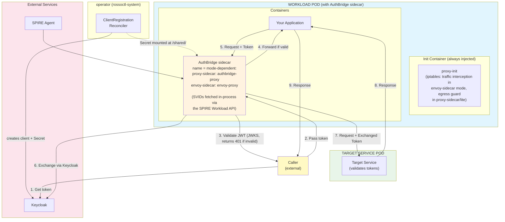
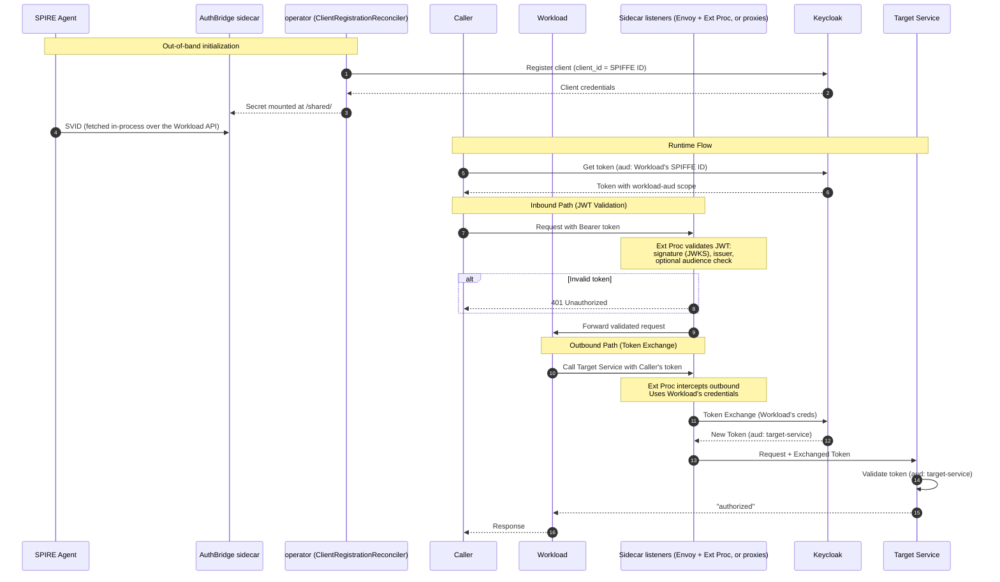

# Cortex

Cortex provides **secure, transparent token management** for Kubernetes workloads. The shared library is at [`core/`](../core/); the sidecar binaries live under [`cmd/`](../cmd/) (see [`cmd/README.md`](../cmd/README.md) for which pins which mode). Keycloak client registration is handled by the [operator](https://github.com/rossoctl/operator)'s `ClientRegistrationReconciler` (no in-pod registration sidecar). Together with [SPIFFE/SPIRE](https://spiffe.io), this enables zero-trust authentication flows.

> **📘 Looking to run the demo?** See the [Weather Agent](../demos/weather-agent/demo-ui.md) or [GitHub Issue Agent](../demos/github-issue/demo.md) demos for step-by-step instructions, and [Token-Exchange Routes](../demos/token-exchange-routes/README.md) for route configuration.

## Deployment Modes

Sidecar container images:

| Image | Contents |
|-------|----------|
| `authbridge` | proxy-sidecar: the cortex binary |
| `authbridge-envoy` | envoy-sidecar combined: Envoy + ext_proc |
| `authbridge-lite` | `cortex` built with the `lite` profile (see `scripts/profile-tags`), a sidecar minimum. A build variant, not a separate binary |

| Mode | Image | Use Case | How It Works |
|------|-------|----------|-------------|
| `proxy-sidecar` (default) | `authbridge` | HTTP_PROXY-based forward + reverse proxies | Agent routes outbound traffic through forward proxy; reverse proxy validates inbound JWTs |
| `envoy-sidecar` | `authbridge-envoy` | Transparent interception via iptables | Envoy intercepts all traffic, delegates auth to authbridge via ext_proc gRPC |

There are only these two modes. `lite` is a build *profile*, not a mode: the
`authbridge-lite` image runs the `cortex` binary in `proxy-sidecar`
mode with a trimmed plugin set (see the profile table below).

The operator resolves the mode per workload from `AgentRuntime.Spec.AuthBridgeMode` → namespace ConfigMap → deprecated `rossoctl.io/authbridge-mode` annotation → cluster default (`proxy-sidecar`). See operator#361.

The runtime library at [`core/`](../core/) holds the plugin framework, every listener (the Envoy ext_proc server and the HTTP proxies), the cost pipeline, the session store, and the auth primitives — auth being 1.6% of its non-test lines. It is not protocol-free: `listener/extproc` depends on gRPC and `envoyproxy/go-control-plane`. See [`core/README.md`](../core/README.md) for the package reference and the measured breakdown.

## Plugin Catalog

See [`docs/plugin-catalog.md`](./plugin-catalog.md) for the full list of implemented pipeline plugins, what each does, and its configuration options.

## Architecture (Operator-Injected)

The following describes the operator-injected sidecar deployment. After cortex#411 each mode is served by its own image (one container per pod). SPIRE credentials are fetched **in-process** by `core/spiffe`'s Provider over the Workload API. The legacy `authbridge-unified`, `authbridge-light`, `envoy-with-processor`, and standalone `client-registration` / `spiffe-helper` sidecars are gone — there is no bundled `spiffe-helper` binary and `SPIRE_ENABLED` no longer gates anything.

### `spiffe:` configuration

One top-level `spiffe:` block in the runtime config drives the in-process
Provider that supplies X.509-SVIDs to the mTLS listeners and a JWT-SVID to the
`token-exchange` plugin (when its `identity.type` is `spiffe`). An absent block
constructs no Provider at all.

```yaml
spiffe:
  socket: "unix:///spiffe-workload-api/spire-agent.sock"   # SPIRE agent socket
  mirror_files: true    # write the /opt mirror on every rotation (default)
  mirror_dir: "/opt"    # where the mirror files land
```

- `socket` (string) — the SPIRE agent's Workload API socket. Must be a
  `unix://` URL; anything else fails at startup rather than at first dial.
  Default `unix:///spiffe-workload-api/spire-agent.sock`.
- `mirror_files` (bool) — when true (the default), an in-process goroutine
  writes `/opt/svid.pem`, `/opt/svid_key.pem`, `/opt/svid_bundle.pem` and
  `/opt/jwt_svid.token` on every rotation, for external readers (e2e probes,
  debugging, future Envoy filesystem SDS). The listeners themselves read SVIDs
  in memory and never re-read the files.
- `mirror_dir` (string) — directory for the mirror files, default `/opt`. Only
  used when `mirror_files` is true.

The JWT-SVID audience that `token-exchange` uses as a client assertion is
per-plugin (`token-exchange`'s `identity.jwt_audience`), not part of this block.


### What Cortex Does

Cortex solves the challenge of **secure service-to-service authentication** in Kubernetes:

1. **Automatic Identity** - Workloads automatically obtain their identity from SPIFFE/SPIRE and register as Keycloak clients using their SPIFFE ID (e.g., `spiffe://example.com/ns/default/sa/myapp`)

2. **Token-Based Authorization** - Callers obtain JWT tokens from Keycloak with the workload's identity as the audience, authorizing them to invoke specific services

3. **Transparent Token Exchange** - A sidecar intercepts outgoing requests, validates incoming tokens, and exchanges them for tokens with the appropriate target audience—all without application code changes

4. **Target Service Validation** - Target services validate the exchanged token, ensuring it has the correct audience before authorizing requests

## Architecture

```
                  Incoming request (with JWT)
                        │
                        ▼
┌───────────────────────────────────────────────────────────────────────┐
│                         WORKLOAD POD                                  │
│                   (with AuthBridge sidecars)                          │
│                                                                       │
│  ┌─────────────────────────────────────────────────────────────────┐  │
│  │  Init Container: proxy-init (iptables intercepts pod traffic,   │  │
│  │  excluding Keycloak port)                                       │  │
│  └─────────────────────────────────────────────────────────────────┘  │
│                        │                                              │
│                        ▼                                              │
│  ┌─────────────────────────────────────────────────────────────────┐  │
│  │  AuthBridge Sidecar (combined image)                            │  │
│  │  Container name = mode-dependent:                               │  │
│  │    proxy-sidecar (default): authbridge-proxy                    │  │
│  │    envoy-sidecar:           envoy-proxy                         │  │
│  │                                                                 │  │
│  │  INBOUND:  Validates JWT (signature + issuer via JWKS)          │  │
│  │            Returns 401 Unauthorized if invalid                  │  │
│  │  OUTBOUND: Exchanges token → target-service audience            │  │
│  │            (using Workload's credentials)                       │  │
│  └──────────────────────┬──────────────────────────────────────────┘  │
│            ▲ outbound   │ inbound                                     │
│            │ request    │ (validated)                                 │
│            │            ▼                                             │
│  ┌─────────┴───────────────────────────────────────────────────────┐  │
│  │  Your App                                                       │  │
│  │  (SVIDs are fetched in-process by the sidecar above over the    │  │
│  │   SPIRE Workload API; no spiffe-helper container)               │  │
│  └─────────────────────────────────────────────────────────────────┘  │
└───────────────────────────────────────────────────────────────────────┘
   ▲
   │ Out-of-band: operator's ClientRegistrationReconciler
   │ creates the Keycloak client + a rossoctl-keycloak-client-credentials
   │ Secret. The webhook mounts that Secret into the AuthBridge sidecar
   │ at /shared/client-{id,secret}.txt — no in-pod registration sidecar.
                        │
                        │ Exchanged token (aud: target-service)
                        ▼
              ┌─────────────────────┐
              │  TARGET SERVICE POD │
              │                     │
              │  Validates token    │
              │  with audience      │
              │  "target-service"   │
              └─────────────────────┘
```

<details>
<summary><b>📊 Mermaid Architecture Diagram (click to expand)</b></summary>



</details>

## Components

### Workload Pod

After cortex#411 a workload pod has the application
container plus a single combined AuthBridge sidecar. It also has a one-shot
`proxy-init` init container in every mode: in envoy-sidecar mode it intercepts
inbound and outbound traffic, and in proxy-sidecar mode (the cluster default)
and `lite` it runs the always-on `enforce-redirect` egress guard. SVIDs are
fetched in-process by the sidecar over the SPIRE
Workload API — there is no `spiffe-helper` container — and client
registration runs in the operator, not the pod.

| Component | Type | Mode | Purpose |
|-----------|------|------|---------|
| `proxy-init` | init | all modes | Envoy-sidecar: iptables intercept inbound and outbound traffic (excludes Keycloak port to avoid token-exchange loops). Proxy-sidecar/lite: the `enforce-redirect` egress guard, always-on. See [`deploy/proxy-init/README.md`](../deploy/proxy-init/README.md). |
| `Your App` | container | both | Your application |
| `authbridge-proxy` | container | proxy-sidecar (default) | Sidecar from the `authbridge` image: HTTP forward + reverse proxies, full plugin set (jwt-validation + token-exchange + a2a/mcp/inference parsers). Fetches SVIDs in-process. |
| `envoy-proxy` | container | envoy-sidecar | Combined sidecar from the `authbridge-envoy` image: Envoy + ext_proc. Validates inbound JWTs (signature + issuer via JWKS) and exchanges outbound tokens; HTTPS is TLS-passthrough. |

### Target Service Pod

Any downstream service that validates incoming tokens have the expected audience.

## End-to-End Flow

**Initialization (out of band, before/at pod startup):**
```
  SPIRE Agent             AuthBridge Sidecar                Keycloak
       │                        │                                │
       │  0. SVIDs              │                                │
       │───────────────────────►│  (fetched in-process by        │
       │  (SPIFFE ID,           │   core/spiffe's Provider over  │
       │   rotated)             │   the Workload API — no        │
       │                        │   spiffe-helper container)     │
       │                        │                                │
       │                        │  1. Read client credentials    │
       │                        │◄─── /shared/client-{id,secret}.txt
       │                        │    (operator's ClientRegistration-
       │                        │     Reconciler registered the
       │                        │     workload out of band,       │
       │                        │     client_id = SPIFFE ID,      │
       │                        │     and the webhook mounts the  │
       │                        │     Secret it created)          │
```

**Runtime Flow:**
```
  Caller             Workload Pod              Keycloak      Target Service
    │                     │                        │               │
    │  2. Get token       │                        │               │
    │  (aud: Workload's SPIFFE ID)                 │               │
    │─────────────────────────────────────────────►│               │
    │◄─────────────────────────────────────────────│               │
    │  Token (aud: Workload)                       │               │
    │                     │                        │               │
    │  3. Pass token      │                        │               │
    │  to Workload        │                        │               │
    │────────────────────►│                        │               │
    │                     │──────────┐             │               │
    │                     │  Envoy intercepts      │               │
    │                     │  inbound request       │               │
    │                     │          │             │               │
    │                     │  Ext Proc validates    │               │
    │                     │  JWT (signature +      │               │
    │                     │  issuer via JWKS)      │               │
    │                     │          │             │               │
    │                     │  401 if invalid ──────►│ (rejected)    │
    │                     │          │             │               │
    │                     │  4. Forward to App     │               │
    │                     │  if valid              │               │
    │                     │◄─────────┘             │               │
    │                     │                        │               │
    │                     │  5. Workload calls     │               │
    │                     │  Target Service with   │               │
    │                     │  Caller's token        │               │
    │                     │──────────┐             │               │
    │                     │          │             │               │
    │                     │  Envoy intercepts      │               │
    │                     │  outbound request      │               │
    │                     │          │             │               │
    │                     │  6. Token Exchange     │               │
    │                     │  (using Workload creds)│               │
    │                     │───────────────────────►│               │
    │                     │◄───────────────────────│               │
    │                     │  New token (aud: target-service)       │
    │                     │          │             │               │
    │                     │  7. Forward request    │               │
    │                     │  with exchanged token  │               │
    │                     │───────────────────────────────────────►│
    │                     │                        │               │
    │                     │◄───────────────────────────────────────│
    │                     │  "authorized"          │               │
    │◄────────────────────│                        │               │
    │  Response           │                        │               │
```

## What Gets Verified

| Step | Component | Verification |
|------|-----------|--------------|
| 0 | AuthBridge sidecar (`core/spiffe` Provider) | SVID obtained in-process from the SPIRE Agent over the Workload API |
| 1 | Operator (`ClientRegistrationReconciler`) | Workload registered with Keycloak out of band (client_id = SPIFFE ID); credentials mounted at `/shared/` |
| 2 | Caller | Token obtained with `aud: Workload's SPIFFE ID` |
| 3 | Envoy + Ext Proc (inbound) | Inbound JWT validated: signature verified via JWKS, issuer checked, optional audience check. Returns 401 if invalid. |
| 4 | Workload | Validated request forwarded to application |
| 5 | Envoy + Ext Proc (outbound) | Outbound request intercepted; token exchanged using Workload's credentials → `aud: target-service` |
| 6 | Target Service | Token validated (`aud: target-service`), returns `"authorized"` |

## Detailed End-to-End Flow

<details>
<summary><b>📊 Mermaid Diagram (click to expand)</b></summary>



### Detailed Flow Summary

| Step | From → To | Action |
|------|-----------|--------|
| **Initialization (out of band)** |||
| 1 | Operator → Keycloak | Register client (`client_id` = SPIFFE ID) |
| 2 | Keycloak → Operator | Return client credentials (Secret mounted at `/shared/` by the webhook) |
| 3 | SPIRE → AuthBridge sidecar | Issue SVID, fetched in-process over the Workload API (no `spiffe-helper` container) |
| **Runtime Phase — Inbound (JWT Validation)** |||
| 4 | Caller → Keycloak | Request token (`aud`: Workload's SPIFFE ID) |
| 5 | Keycloak → Caller | Return token with workload-aud scope |
| 6 | Caller → Envoy (inbound) | Request intercepted by iptables, routed to Envoy inbound listener |
| 7 | Envoy → Ext Proc | Validate JWT: signature (JWKS), issuer, optional audience. Returns 401 if invalid. |
| 8 | Envoy → Workload | Forward validated request to application |
| **Runtime Phase — Outbound (Token Exchange)** |||
| 9 | Workload → Envoy (outbound) | Outbound request intercepted by iptables, routed to Envoy outbound listener |
| 10 | Envoy → Ext Proc → Keycloak | Token Exchange (using Workload's credentials) |
| 11 | Keycloak → Envoy | Return new token (`aud`: target-service) |
| 12 | Envoy → Target Service | Forward request with exchanged token |
| 13 | Target Service | Validate token (`aud`: target-service) |
| 14 | Target Service → Workload | Return "authorized" |
| 15 | Workload → Caller | Return response |

</details>

## Key Security Properties

- **No Static Secrets** - Credentials are dynamically generated during registration
- **Short-Lived Tokens** - JWT tokens expire and must be refreshed
- **Inbound JWT Validation** - Incoming requests are validated at the sidecar (signature via JWKS, issuer, optional audience) before reaching the application
- **Self-Audience Scoping** - Tokens include the Workload's own identity as audience, enabling token exchange
- **Same Identity for Exchange** - The sidecar uses the Workload's credentials (same SPIFFE ID), matching the token's audience
- **Transparent to Application** - Both inbound validation and outbound token exchange are handled by the sidecar; applications don't need to implement either
- **Configurable Targets** - Route-based configuration maps destination hosts to target audiences

## Prerequisites

- Kubernetes cluster (Kind recommended for local development)
- SPIRE installed and running (server + agent) - for SPIFFE version
- Keycloak deployed
- Docker/Podman for building images

### Quick Setup

The easiest way to get all prerequisites is to use the [Rossoctl Quickstart](https://www.rossoctl.dev/docs/get-started/kubernetes).

## Getting Started

See [`demos/README.md`](../demos/README.md) for the full demo index and a
recommended learning path — from the Weather Agent (inbound validation, webhook
injection) through the GitHub Issue Agent (transparent token exchange +
scope-based access) to the token-exchange routes reference.

### Route-Based Configuration

AuthBridge supports per-host token exchange configuration via `routes.yaml`:

```yaml
# Exchange tokens for target-alpha audience when calling this host
- host: "target-alpha-service.authbridge.svc.cluster.local"
  target_audience: "target-alpha"
  token_scopes: "openid target-alpha-aud"

# Glob patterns supported
- host: "*.internal.svc.cluster.local"
  passthrough: true  # Skip token exchange
```

### Keycloak Sync

Use `keycloak_sync.py` to reconcile routes.yaml with Keycloak configuration:

```bash
python scripts/keycloak_sync.py --config routes.yaml --agent-client "spiffe://..." --yes
```

This creates target clients, audience scopes, and assigns scopes to the agent.

## Build-tag plugin selection

Every plugin is opt-in. A binary links exactly the plugins its build tags name,
so an artifact's contents are its tag list and nothing more. **A build with no
tags registers no plugins**, and will reject any config that names one with
`unknown plugin "..." (registered: [])`.

Tag sets are not written by hand. `scripts/profile-tags` holds one
declarative profile per shipped artifact and emits its tags:

| Profile | Artifact | Plugins |
|---------|----------|---------|
| `local` | desktop `cortex` | the three parsers + `tool-prune` |
| `full` | `authbridge` image, Kubernetes proxy-sidecar | all fourteen |
| `lite` | `authbridge-lite` image | sidecar minimum: jwt-validation, token-exchange, litellm-budget-track, static-inject |
| `envoy` | `authbridge-envoy` image | envoy-sidecar set |
| `cpex` | `authbridge-cpex` image | cpex set |

`context-guru` and `session-budget` belong to no profile — both are heavy
(roughly 16 MiB and 6 MiB respectively) and are linked only on request.

### Usage

**Go build:**

```bash
# Desktop set
go build -tags "$(go -C scripts/profile-tags run . local)" ./cmd/cortex

# Everything a Kubernetes sidecar ships
go build -tags "$(go -C scripts/profile-tags run . full)" ./cmd/cortex

# A profile plus one optional plugin
go build -tags "$(go -C scripts/profile-tags run . full),include_plugin_sessionbudget" \
  ./cmd/cortex
```

**Docker build:**

```bash
docker build --build-arg GO_BUILD_TAGS="$(go -C scripts/profile-tags run . full)" \
  -f cmd/cortex/Dockerfile .
```

Tags combine with commas. Go does **not** error on a tag that matches nothing, so
a typo silently drops a plugin — prefer a profile name over a hand-written list.

### Adding build tags to a new plugin

To make a plugin excludable:

1. Create a `plugins_<name>.go` file in each `cmd/` binary that imports the plugin:

```go
//go:build include_plugin_<name>

package main

import _ "github.com/rossoctl/cortex/core/plugins/<name>"
```

2. Never import a plugin package from `main.go`. An unconditional import cannot be
   excluded by any tag, and nothing reports that.

3. Name the plugin in every profile that should carry it, in
   `scripts/profile-tags/profiles.go` — or add it to `optional` if it deliberately
   ships in none. A plugin in neither fails the accounting guard.

4. Avoid a filename whose suffix is a GOOS or GOARCH token. `plugins_sparc.go`
   carries an implicit `GOARCH=sparc` constraint and compiles on no normal
   machine, silently dropping the plugin — which is why the sparc plugin's file is
   `plugins_sparcplugin.go`. A guard test enforces this.

The build constraint `include_plugin_<name>` means the file is compiled in only
when `-tags include_plugin_<name>` is passed.

## Component Documentation

- [core](../core/README.md) — The runtime library: framework, listeners, cost, session store, auth (Go module)
- [cmd/cortex](../cmd/cortex/) — proxy-sidecar binary (default mode, full plugin set)
- [cmd/cortex-envoy](../cmd/cortex-envoy/) — envoy-sidecar binary (Envoy + ext_proc, full plugin set)
- `authbridge-lite` image — `cmd/cortex` built with the `lite` profile (see `scripts/profile-tags`); a build variant, not a separate binary
- [proxy-init](../deploy/proxy-init/README.md) — iptables init container (traffic interception in envoy-sidecar mode, `enforce-redirect` egress guard in proxy-sidecar/lite)
- [docs/](./) — framework architecture and plugin author references

Keycloak client registration is handled by the [operator](https://github.com/rossoctl/operator)'s `ClientRegistrationReconciler`, not by an in-pod sidecar.

## References

- [Rossoctl Installation](https://github.com/rossoctl/rossoctl/blob/main/docs/operate/install-kubernetes.md)
- [SPIRE Documentation](https://spiffe.io/docs/latest/)
- [OAuth 2.0 Token Exchange (RFC 8693)](https://www.rfc-editor.org/rfc/rfc8693)
